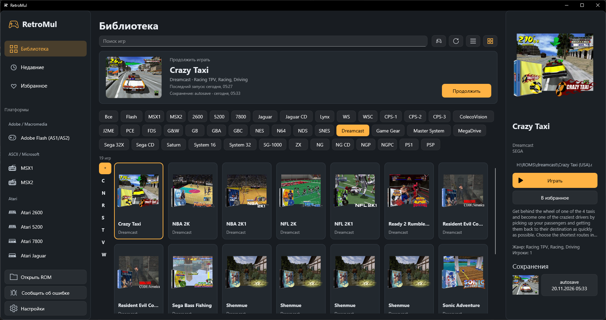

# RetroMul



RetroMul is a multi-system retro game emulator written in Delphi with a FireMonkey interface. It runs games for NES / Famicom, Game Boy, Game Boy Color, Game Boy Advance, SEGA Mega Drive / Genesis, SEGA CD / Mega-CD, SEGA 32X, SEGA SG-1000 / SC-3000 / SF-7000, Othello Multivision, SEGA Master System / Mark III, SEGA Game Gear, Super Nintendo, Neo Geo MVS / AES, Neo Geo CD, Neo Geo Pocket / Pocket Color, Bandai WonderSwan / WonderSwan Color, Sony PlayStation, Capcom Play System I / II / III, and the PC Engine / TurboGrafx / SuperGrafx family. The repository also includes RetroTune, a companion music player, and RetromulTerm, a Windows console frontend.

## Supported systems and ROM formats

The table lists registered systems. Supported files and ROM sets can also be loaded from `.zip`, `.7z`, and `.rar` archives. Disc images must retain their required companion files and tracks.

| System | Supported formats |
| --- | --- |
| Atari 8-bit (400 / 800 / XL / XE / XEGS) | Cartridge images `.car`, `.rom`, `.bin`; disk images `.atr`, `.xfd`; executables `.xex`, `.com` |
| Atari 2600 | `.a26`; `.bin`, `.rom` in the system folder |
| Atari 5200 | `.a52`, Atari 5200 `.car`; `.bin`, `.rom` in the system folder; BIOS embedded |
| Atari 7800 | `.a78`, `.bin`, `.rom` |
| Atari Jaguar | `.j64`, `.bin`, `.rom` |
| Atari Jaguar CD | `.cue`, `.chd`, `.cdi`, `.mds`, `.nrg`, `.ccd`, multi-disc `.m3u` |
| Atari Lynx | `.lnx`, `.lyx`, BS93 `.o` / `.com` / `.bll`; BIOS embedded |
| ColecoVision | `.col`, `.cv`, `.rom`, `.bin` |
| NES / Famicom | `.nes`; Famicom Disk System `.fds`, `.qd` |
| Famicom Disk System | `.fds`, `.qd` |
| Game Boy | `.gb`, `.gbx` |
| Game Boy Color | `.gbc`, `.gbx` |
| Game & Watch | `.gw`, `.mgw`, catalogued MAME `.zip` sets with SVG screens |
| Game Boy Advance | `.gba` |
| Nintendo 64 (experimental) | `.z64`, `.n64`, `.v64` |
| Nintendo DS (experimental) | `.nds` |
| Adobe Flash (experimental) | `.swf` with ActionScript 1/2 (AVM1) or limited ActionScript 3 (AVM2) support |
| Java ME / J2ME (initial implementation) | `.jar`, optional adjacent `.jad`; |
| SEGA Mega Drive / Genesis | `.md`, `.bin`, `.gen`, `.smd` |
| SEGA CD / Mega-CD | `.cue`, `.iso`, `.chd`, `.mds`, `.nrg` |
| SEGA 32X | `.32x`, `.bin`, `.gen`, `.md`, `.smd` |
| SEGA System 16A / 16B | Catalogued MAME `.zip`, `.7z`, `.rar` sets |
| SEGA System 18 | Catalogued MAME `.zip`, `.7z`, `.rar` sets |
| SEGA System 32 (experimental) | Catalogued MAME `.zip`, `.7z`, `.rar` sets |
| SEGA SG-1000 | `.sg` (legacy `.sms` images in `sg1000/`) |
| SEGA SC-3000 | `.sc` |
| SEGA SF-7000 | `.sf7`, `.sf`, `.dsk` (external IPL required) |
| Othello Multivision | `.mv` |
| SEGA Master System / Mark III | `.sms` |
| SEGA Game Gear | `.gg` |
| MSX1 | `.rom`, `.mx1`, `.dsk`, `.cas`, `.wav` |
| MSX2 | `.rom`, `.mx2`, `.dsk`, `.cas`, `.wav` |
| MSX2+ | `.rom`, `.mx2`, `.mxp`, `.dsk`, `.cas`, `.wav` |
| SEGA Saturn | `.iso`, `.cue`, `.chd`, `.mds`, `.nrg`; BIOS images `.bin`, `.rom`, `.bios` |
| SEGA Dreamcast | `.gdi`, `.cdi`, `.chd`, `.cue`, `.iso`, `.mds`, `.nrg`, homebrew `.elf`, multi-disc `.m3u` |
| Sony PlayStation (PS1) | `.cue`, `.chd`, `.iso`, `.mds`, `.nrg`, raw `.bin`, PS-X `.exe`, multi-disc `.m3u` |
| Sony PSP (experimental) | `.elf`, `.prx`, `.pbp`, encrypted executables, ISO9660 `.iso`, CISO v1 `.cso` |
| ZX Spectrum family / clones | `.sna`, `.z80`, `.tap`, `.tzx`, `.trd`, `.scl`, `.dsk`, `.dck`, `.pro`, `.kdi`, `.ide`, `.mmc` |
| Super Nintendo / Super Famicom | `.sfc`, `.smc`, `.swc`, `.fig` |
| Neo Geo MVS / AES | Named MAME ROM sets in `.zip`, `.7z`, `.rar`; unencrypted NeoSD `.neo` images |
| Neo Geo CD / CDZ | `.iso`, `.cue` with BIN/PCM WAV tracks, `.chd`, `.mds`, `.nrg` |
| Neo Geo Pocket | `.ngp`, `.ngc` |
| Neo Geo Pocket Color | `.ngp`, `.ngc` |
| WonderSwan | `.ws`, `.wsc` (model detected from the image) |
| WonderSwan Color | `.wsc`, `.ws` |
| Capcom Play System I (CPS-1) | Named arcade ROM sets in `.zip`, `.7z`, `.rar` |
| Capcom Play System II (CPS-2) | Named arcade ROM sets in `.zip`, `.7z`, `.rar` |
| Capcom Play System III (CPS-3) | Supported SIMM / No-CD ROM sets in `.zip`, `.7z`, `.rar` |
| PC Engine / TurboGrafx-16 | `.pce`, single-HuCard archives |
| SuperGrafx | `.sgx`, `.pce`, single-HuCard archives |
| PC Engine CD / Duo / Arcade Card | `.cue`, `.iso`, `.chd`, `.mds`, `.nrg` (built-in System Cards 1/2/3) |

<details>
<summary>NES / Famicom mapper support</summary>

<table>
<tbody>
<tr>
<td>🟩&nbsp;0</td><td>🟩&nbsp;1</td><td>🟩&nbsp;2</td><td>🟩&nbsp;3</td><td>🟩&nbsp;4</td>
<td>🟩&nbsp;5</td><td>🟩&nbsp;6</td><td>🟩&nbsp;7</td><td>🟩&nbsp;8</td><td>🟩&nbsp;9</td>
</tr>
<tr>
<td>🟩&nbsp;10</td><td>🟩&nbsp;11</td><td>🟩&nbsp;12</td><td>🟩&nbsp;13</td><td>🟩&nbsp;14</td>
<td>🟩&nbsp;15</td><td>🟩&nbsp;16</td><td>🟩&nbsp;17</td><td>🟩&nbsp;18</td><td>🟩&nbsp;19</td>
</tr>
<tr>
<td>🟨&nbsp;20</td><td>🟩&nbsp;21</td><td>🟩&nbsp;22</td><td>🟩&nbsp;23</td><td>🟩&nbsp;24</td>
<td>🟩&nbsp;25</td><td>🟩&nbsp;26</td><td>🟩&nbsp;27</td><td>🟩&nbsp;28</td><td>🟩&nbsp;29</td>
</tr>
<tr>
<td>🟩&nbsp;30</td><td>🟩&nbsp;31</td><td>🟩&nbsp;32</td><td>🟩&nbsp;33</td><td>🟩&nbsp;34</td>
<td>🟩&nbsp;35</td><td>🟩&nbsp;36</td><td>🟩&nbsp;37</td><td>🟩&nbsp;38</td><td>🟩&nbsp;39</td>
</tr>
<tr>
<td>🟩&nbsp;40</td><td>🟩&nbsp;41</td><td>🟩&nbsp;42</td><td>🟩&nbsp;43</td><td>🟩&nbsp;44</td>
<td>🟩&nbsp;45</td><td>🟩&nbsp;46</td><td>🟩&nbsp;47</td><td>🟩&nbsp;48</td><td>🟩&nbsp;49</td>
</tr>
<tr>
<td>🟩&nbsp;50</td><td>🟩&nbsp;51</td><td>🟩&nbsp;52</td><td>🟩&nbsp;53</td><td>🟩&nbsp;54</td>
<td>🟩&nbsp;55</td><td>🟩&nbsp;56</td><td>🟩&nbsp;57</td><td>🟩&nbsp;58</td><td>🟩&nbsp;59</td>
</tr>
<tr>
<td>🟩&nbsp;60</td><td>🟩&nbsp;61</td><td>🟩&nbsp;62</td><td>🟩&nbsp;63</td><td>🟩&nbsp;64</td>
<td>🟩&nbsp;65</td><td>🟩&nbsp;66</td><td>🟩&nbsp;67</td><td>🟩&nbsp;68</td><td>🟩&nbsp;69</td>
</tr>
<tr>
<td>🟩&nbsp;70</td><td>🟩&nbsp;71</td><td>🟩&nbsp;72</td><td>🟩&nbsp;73</td><td>🟩&nbsp;74</td>
<td>🟩&nbsp;75</td><td>🟩&nbsp;76</td><td>🟩&nbsp;77</td><td>🟩&nbsp;78</td><td>🟩&nbsp;79</td>
</tr>
<tr>
<td>🟩&nbsp;80</td><td>🟩&nbsp;81</td><td>🟩&nbsp;82</td><td>🟩&nbsp;83</td><td>💠&nbsp;84</td>
<td>🟩&nbsp;85</td><td>🟩&nbsp;86</td><td>🟩&nbsp;87</td><td>🟩&nbsp;88</td><td>🟩&nbsp;89</td>
</tr>
<tr>
<td>🟩&nbsp;90</td><td>🟩&nbsp;91</td><td>🟩&nbsp;92</td><td>🟩&nbsp;93</td><td>🟩&nbsp;94</td>
<td>🟩&nbsp;95</td><td>🟩&nbsp;96</td><td>🟩&nbsp;97</td><td>⬜&nbsp;98</td><td>🟩&nbsp;99</td>
</tr>
<tr>
<td>🟩&nbsp;100</td><td>🟩&nbsp;101</td><td>💠&nbsp;102</td><td>🟩&nbsp;103</td><td>🟩&nbsp;104</td>
<td>🟩&nbsp;105</td><td>🟩&nbsp;106</td><td>🟩&nbsp;107</td><td>🟩&nbsp;108</td><td>💠&nbsp;109</td>
</tr>
<tr>
<td>💠&nbsp;110</td><td>🟩&nbsp;111</td><td>🟩&nbsp;112</td><td>🟩&nbsp;113</td><td>🟩&nbsp;114</td>
<td>🟩&nbsp;115</td><td>🟩&nbsp;116</td><td>🟩&nbsp;117</td><td>🟩&nbsp;118</td><td>🟩&nbsp;119</td>
</tr>
<tr>
<td>🟩&nbsp;120</td><td>🟩&nbsp;121</td><td>🟩&nbsp;122</td><td>🟩&nbsp;123</td><td>🟩&nbsp;124</td>
<td>🟩&nbsp;125</td><td>🟩&nbsp;126</td><td>🟩&nbsp;127</td><td>🟩&nbsp;128</td><td>💠&nbsp;129</td>
</tr>
<tr>
<td>💠&nbsp;130</td><td>💠&nbsp;131</td><td>🟩&nbsp;132</td><td>🟩&nbsp;133</td><td>🟩&nbsp;134</td>
<td>💠&nbsp;135</td><td>🟩&nbsp;136</td><td>🟩&nbsp;137</td><td>🟩&nbsp;138</td><td>🟩&nbsp;139</td>
</tr>
<tr>
<td>🟩&nbsp;140</td><td>🟩&nbsp;141</td><td>🟩&nbsp;142</td><td>🟩&nbsp;143</td><td>🟩&nbsp;144</td>
<td>🟩&nbsp;145</td><td>🟩&nbsp;146</td><td>🟩&nbsp;147</td><td>🟩&nbsp;148</td><td>🟩&nbsp;149</td>
</tr>
<tr>
<td>🟩&nbsp;150</td><td>🟩&nbsp;151</td><td>🟩&nbsp;152</td><td>🟩&nbsp;153</td><td>🟩&nbsp;154</td>
<td>🟩&nbsp;155</td><td>🟩&nbsp;156</td><td>🟩&nbsp;157</td><td>🟩&nbsp;158</td><td>🟩&nbsp;159</td>
</tr>
<tr>
<td>💠&nbsp;160</td><td>💠&nbsp;161</td><td>🟩&nbsp;162</td><td>🟩&nbsp;163</td><td>🟩&nbsp;164</td>
<td>🟩&nbsp;165</td><td>🟩&nbsp;166</td><td>🟩&nbsp;167</td><td>🟩&nbsp;168</td><td>🟩&nbsp;169</td>
</tr>
<tr>
<td>🟩&nbsp;170</td><td>🟩&nbsp;171</td><td>🟩&nbsp;172</td><td>🟩&nbsp;173</td><td>🟩&nbsp;174</td>
<td>🟩&nbsp;175</td><td>🟩&nbsp;176</td><td>🟩&nbsp;177</td><td>🟩&nbsp;178</td><td>🟩&nbsp;179</td>
</tr>
<tr>
<td>🟩&nbsp;180</td><td>💠&nbsp;181</td><td>🟩&nbsp;182</td><td>🟩&nbsp;183</td><td>🟩&nbsp;184</td>
<td>🟩&nbsp;185</td><td>🟩&nbsp;186</td><td>🟩&nbsp;187</td><td>🟩&nbsp;188</td><td>🟩&nbsp;189</td>
</tr>
<tr>
<td>🟩&nbsp;190</td><td>🟩&nbsp;191</td><td>🟩&nbsp;192</td><td>🟩&nbsp;193</td><td>🟩&nbsp;194</td>
<td>🟩&nbsp;195</td><td>🟩&nbsp;196</td><td>🟩&nbsp;197</td><td>🟩&nbsp;198</td><td>🟩&nbsp;199</td>
</tr>
<tr>
<td>🟩&nbsp;200</td><td>🟩&nbsp;201</td><td>🟩&nbsp;202</td><td>🟩&nbsp;203</td><td>🟩&nbsp;204</td>
<td>🟩&nbsp;205</td><td>🟩&nbsp;206</td><td>🟩&nbsp;207</td><td>🟩&nbsp;208</td><td>🟩&nbsp;209</td>
</tr>
<tr>
<td>🟩&nbsp;210</td><td>🟩&nbsp;211</td><td>🟩&nbsp;212</td><td>🟩&nbsp;213</td><td>🟩&nbsp;214</td>
<td>🟩&nbsp;215</td><td>🟩&nbsp;216</td><td>🟩&nbsp;217</td><td>🟩&nbsp;218</td><td>🟩&nbsp;219</td>
</tr>
<tr>
<td>💠&nbsp;220</td><td>🟩&nbsp;221</td><td>🟩&nbsp;222</td><td>💠&nbsp;223</td><td>🟩&nbsp;224</td>
<td>🟩&nbsp;225</td><td>🟩&nbsp;226</td><td>🟩&nbsp;227</td><td>🟩&nbsp;228</td><td>🟩&nbsp;229</td>
</tr>
<tr>
<td>🟩&nbsp;230</td><td>🟩&nbsp;231</td><td>🟩&nbsp;232</td><td>🟩&nbsp;233</td><td>🟩&nbsp;234</td>
<td>🟩&nbsp;235</td><td>🟩&nbsp;236</td><td>🟩&nbsp;237</td><td>🟩&nbsp;238</td><td>🟩&nbsp;239</td>
</tr>
<tr>
<td>🟩&nbsp;240</td><td>🟩&nbsp;241</td><td>🟩&nbsp;242</td><td>🟩&nbsp;243</td><td>🟩&nbsp;244</td>
<td>🟩&nbsp;245</td><td>🟩&nbsp;246</td><td>⬜&nbsp;247</td><td>💠&nbsp;248</td><td>🟩&nbsp;249</td>
</tr>
<tr>
<td>🟩&nbsp;250</td><td>💠&nbsp;251</td><td>🟩&nbsp;252</td><td>🟩&nbsp;253</td><td>🟩&nbsp;254</td>
<td>🟩&nbsp;255</td><td>🟩&nbsp;256</td><td>🟩&nbsp;257</td><td>🟩&nbsp;258</td><td>🟩&nbsp;259</td>
</tr>
<tr>
<td>🟩&nbsp;260</td><td>🟩&nbsp;261</td><td>🟩&nbsp;262</td><td>🟩&nbsp;263</td><td>🟩&nbsp;264</td>
<td>🟩&nbsp;265</td><td>🟩&nbsp;266</td><td>🟩&nbsp;267</td><td>🟩&nbsp;268</td><td>🟩&nbsp;269</td>
</tr>
<tr>
<td>🟩&nbsp;270</td><td>🟩&nbsp;271</td><td>🟩&nbsp;272</td><td>🟩&nbsp;273</td><td>🟩&nbsp;274</td>
<td>💠&nbsp;275</td><td>🟥&nbsp;276</td><td>🟩&nbsp;277</td><td>🟥&nbsp;278</td><td>🟩&nbsp;279</td>
</tr>
<tr>
<td>🟩&nbsp;280</td><td>🟩&nbsp;281</td><td>🟩&nbsp;282</td><td>🟩&nbsp;283</td><td>🟩&nbsp;284</td>
<td>🟩&nbsp;285</td><td>🟩&nbsp;286</td><td>🟩&nbsp;287</td><td>🟩&nbsp;288</td><td>🟩&nbsp;289</td>
</tr>
<tr>
<td>🟩&nbsp;290</td><td>🟩&nbsp;291</td><td>🟩&nbsp;292</td><td>🟩&nbsp;293</td><td>🟩&nbsp;294</td>
<td>🟩&nbsp;295</td><td>🟩&nbsp;296</td><td>🟩&nbsp;297</td><td>🟩&nbsp;298</td><td>🟩&nbsp;299</td>
</tr>
<tr>
<td>🟩&nbsp;300</td><td>🟩&nbsp;301</td><td>🟩&nbsp;302</td><td>🟩&nbsp;303</td><td>🟩&nbsp;304</td>
<td>🟩&nbsp;305</td><td>🟩&nbsp;306</td><td>🟩&nbsp;307</td><td>🟩&nbsp;308</td><td>🟩&nbsp;309</td>
</tr>
<tr>
<td>🟩&nbsp;310</td><td>🟩&nbsp;311</td><td>🟩&nbsp;312</td><td>🟩&nbsp;313</td><td>🟩&nbsp;314</td>
<td>🟩&nbsp;315</td><td>🟩&nbsp;316</td><td>🟩&nbsp;317</td><td>🟩&nbsp;318</td><td>🟩&nbsp;319</td>
</tr>
<tr>
<td>🟩&nbsp;320</td><td>🟩&nbsp;321</td><td>🟩&nbsp;322</td><td>🟩&nbsp;323</td><td>🟩&nbsp;324</td>
<td>🟩&nbsp;325</td><td>🟩&nbsp;326</td><td>🟩&nbsp;327</td><td>🟩&nbsp;328</td><td>🟩&nbsp;329</td>
</tr>
<tr>
<td>🟩&nbsp;330</td><td>🟩&nbsp;331</td><td>🟩&nbsp;332</td><td>🟩&nbsp;333</td><td>🟩&nbsp;334</td>
<td>🟩&nbsp;335</td><td>🟩&nbsp;336</td><td>🟩&nbsp;337</td><td>🟩&nbsp;338</td><td>🟩&nbsp;339</td>
</tr>
<tr>
<td>🟩&nbsp;340</td><td>🟩&nbsp;341</td><td>🟩&nbsp;342</td><td>🟩&nbsp;343</td><td>🟩&nbsp;344</td>
<td>🟩&nbsp;345</td><td>🟩&nbsp;346</td><td>🟩&nbsp;347</td><td>🟩&nbsp;348</td><td>🟩&nbsp;349</td>
</tr>
<tr>
<td>🟩&nbsp;350</td><td>🟩&nbsp;351</td><td>🟩&nbsp;352</td><td>🟩&nbsp;353</td><td>🟩&nbsp;354</td>
<td>🟩&nbsp;355</td><td>🟩&nbsp;356</td><td>🟩&nbsp;357</td><td>🟩&nbsp;358</td><td>🟩&nbsp;359</td>
</tr>
<tr>
<td>🟩&nbsp;360</td><td>🟩&nbsp;361</td><td>🟩&nbsp;362</td><td>🟩&nbsp;363</td><td>🟩&nbsp;364</td>
<td>🟩&nbsp;365</td><td>🟩&nbsp;366</td><td>🟩&nbsp;367</td><td>🟩&nbsp;368</td><td>🟩&nbsp;369</td>
</tr>
<tr>
<td>🟩&nbsp;370</td><td>🟩&nbsp;371</td><td>🟩&nbsp;372</td><td>🟩&nbsp;373</td><td>🟩&nbsp;374</td>
<td>🟩&nbsp;375</td><td>🟩&nbsp;376</td><td>🟩&nbsp;377</td><td>🟩&nbsp;378</td><td>🟩&nbsp;379</td>
</tr>
<tr>
<td>🟩&nbsp;380</td><td>🟩&nbsp;381</td><td>🟩&nbsp;382</td><td>🟩&nbsp;383</td><td>🟩&nbsp;384</td>
<td>🟩&nbsp;385</td><td>🟩&nbsp;386</td><td>🟩&nbsp;387</td><td>🟩&nbsp;388</td><td>🟩&nbsp;389</td>
</tr>
<tr>
<td>🟩&nbsp;390</td><td>🟩&nbsp;391</td><td>🟩&nbsp;392</td><td>🟩&nbsp;393</td><td>🟩&nbsp;394</td>
<td>🟩&nbsp;395</td><td>🟩&nbsp;396</td><td>🟩&nbsp;397</td><td>🟩&nbsp;398</td><td>🟩&nbsp;399</td>
</tr>
<tr>
<td>🟩&nbsp;400</td><td>🟩&nbsp;401</td><td>🟩&nbsp;402</td><td>🟩&nbsp;403</td><td>🟩&nbsp;404</td>
<td>🟩&nbsp;405</td><td>🟩&nbsp;406</td><td>🟩&nbsp;407</td><td>🟩&nbsp;408</td><td>🟩&nbsp;409</td>
</tr>
<tr>
<td>🟩&nbsp;410</td><td>🟩&nbsp;411</td><td>🟩&nbsp;412</td><td>🟩&nbsp;413</td><td>🟩&nbsp;414</td>
<td>🟩&nbsp;415</td><td>🟩&nbsp;416</td><td>🟩&nbsp;417</td><td>🟩&nbsp;418</td><td>🟩&nbsp;419</td>
</tr>
<tr>
<td>🟩&nbsp;420</td><td>🟩&nbsp;421</td><td>🟩&nbsp;422</td><td>🟩&nbsp;423</td><td>🟩&nbsp;424</td>
<td>🟩&nbsp;425</td><td>🟩&nbsp;426</td><td>🟩&nbsp;427</td><td>🟩&nbsp;428</td><td>🟩&nbsp;429</td>
</tr>
<tr>
<td>🟩&nbsp;430</td><td>💠&nbsp;431</td><td>🟩&nbsp;432</td><td>🟩&nbsp;433</td><td>🟩&nbsp;434</td>
<td>🟩&nbsp;435</td><td>🟩&nbsp;436</td><td>🟩&nbsp;437</td><td>🟩&nbsp;438</td><td>🟩&nbsp;439</td>
</tr>
<tr>
<td>🟩&nbsp;440</td><td>🟩&nbsp;441</td><td>🟩&nbsp;442</td><td>🟩&nbsp;443</td><td>🟩&nbsp;444</td>
<td>🟩&nbsp;445</td><td>🟩&nbsp;446</td><td>🟩&nbsp;447</td><td>🟩&nbsp;448</td><td>🟩&nbsp;449</td>
</tr>
<tr>
<td>🟩&nbsp;450</td><td>🟩&nbsp;451</td><td>🟩&nbsp;452</td><td>🟩&nbsp;453</td><td>🟩&nbsp;454</td>
<td>🟩&nbsp;455</td><td>🟩&nbsp;456</td><td>🟩&nbsp;457</td><td>🟩&nbsp;458</td><td>🟩&nbsp;459</td>
</tr>
<tr>
<td>🟩&nbsp;460</td><td>🟩&nbsp;461</td><td>🟩&nbsp;462</td><td>🟩&nbsp;463</td><td>🟩&nbsp;464</td>
<td>🟩&nbsp;465</td><td>🟩&nbsp;466</td><td>🟩&nbsp;467</td><td>🟩&nbsp;468</td><td>🟩&nbsp;469</td>
</tr>
<tr>
<td>🟩&nbsp;470</td><td>🟩&nbsp;471</td><td>🟩&nbsp;472</td><td>🟩&nbsp;473</td><td>🟩&nbsp;474</td>
<td>🟩&nbsp;475</td><td>🟩&nbsp;476</td><td>🟩&nbsp;477</td><td>🟩&nbsp;478</td><td>🟩&nbsp;479</td>
</tr>
<tr>
<td>🟩&nbsp;480</td><td>🟩&nbsp;481</td><td>🟩&nbsp;482</td><td>🟩&nbsp;483</td><td>🟩&nbsp;484</td>
<td>🟩&nbsp;485</td><td>🟩&nbsp;486</td><td>🟩&nbsp;487</td><td>🟩&nbsp;488</td><td>🟩&nbsp;489</td>
</tr>
<tr>
<td>🟩&nbsp;490</td><td>🟩&nbsp;491</td><td>🟩&nbsp;492</td><td>🟩&nbsp;493</td><td>🟩&nbsp;494</td>
<td>🟩&nbsp;495</td><td>🟩&nbsp;496</td><td>🟩&nbsp;497</td><td>🟩&nbsp;498</td><td>🟩&nbsp;499</td>
</tr>
<tr>
<td>🟩&nbsp;500</td><td>🟩&nbsp;501</td><td>🟩&nbsp;502</td><td>🟩&nbsp;503</td><td>🟩&nbsp;504</td>
<td>🟩&nbsp;505</td><td>🟩&nbsp;506</td><td>🟩&nbsp;507</td><td>🟩&nbsp;508</td><td>🟩&nbsp;509</td>
</tr>
<tr>
<td>🟩&nbsp;510</td><td>🟩&nbsp;511</td><td>🟩&nbsp;512</td><td>🟩&nbsp;513</td><td>🟩&nbsp;514</td>
<td>🟩&nbsp;515</td><td>🟩&nbsp;516</td><td>🟩&nbsp;517</td><td>🟩&nbsp;518</td><td>🟩&nbsp;519</td>
</tr>
<tr>
<td>🟩&nbsp;520</td><td>🟩&nbsp;521</td><td>🟩&nbsp;522</td><td>🟩&nbsp;523</td><td>🟩&nbsp;524</td>
<td>🟩&nbsp;525</td><td>🟩&nbsp;526</td><td>🟩&nbsp;527</td><td>🟩&nbsp;528</td><td>🟩&nbsp;529</td>
</tr>
<tr>
<td>🟩&nbsp;530</td><td>🟩&nbsp;531</td><td>🟩&nbsp;532</td><td>🟩&nbsp;533</td><td>🟩&nbsp;534</td>
<td>🟩&nbsp;535</td><td>🟩&nbsp;536</td><td>🟩&nbsp;537</td><td>🟩&nbsp;538</td><td>🟩&nbsp;539</td>
</tr>
<tr>
<td>🟩&nbsp;540</td><td>🟩&nbsp;541</td><td>🟩&nbsp;542</td><td>🟩&nbsp;543</td><td>🟩&nbsp;544</td>
<td>🟩&nbsp;545</td><td>🟩&nbsp;546</td><td>🟩&nbsp;547</td><td>🟩&nbsp;548</td><td>🟩&nbsp;549</td>
</tr>
<tr>
<td>🟩&nbsp;550</td><td>🟩&nbsp;551</td><td>🟩&nbsp;552</td><td>🟩&nbsp;553</td><td>🟩&nbsp;554</td>
<td>🟩&nbsp;555</td><td>🟩&nbsp;556</td><td>🟩&nbsp;557</td><td>🟩&nbsp;558</td><td>🟩&nbsp;559</td>
</tr>
<tr>
<td>🟩&nbsp;560</td><td>🟩&nbsp;561</td><td>🟩&nbsp;562</td><td>🟩&nbsp;563</td><td>🟩&nbsp;564</td>
<td>🟩&nbsp;565</td><td>🟩&nbsp;566</td><td>🟩&nbsp;567</td><td>🟩&nbsp;568</td><td>🟩&nbsp;569</td>
</tr>
<tr>
<td>🟩&nbsp;570</td><td>🟩&nbsp;571</td><td>🟩&nbsp;572</td><td>🟩&nbsp;573</td><td>🟩&nbsp;574</td>
<td>🟩&nbsp;575</td><td>🟩&nbsp;576</td><td>🟩&nbsp;577</td><td>🟩&nbsp;578</td><td>🟩&nbsp;579</td>
</tr>
<tr>
<td>🟩&nbsp;580</td><td>🟩&nbsp;581</td><td>🟩&nbsp;582</td><td>🟩&nbsp;583</td><td>🟩&nbsp;584</td>
<td>🟩&nbsp;585</td><td>🟩&nbsp;586</td><td>🟩&nbsp;587</td><td>🟩&nbsp;588</td><td>🟩&nbsp;589</td>
</tr>
<tr>
<td>🟩&nbsp;590</td><td>🟩&nbsp;591</td><td>🟩&nbsp;592</td><td>🟩&nbsp;593</td><td>🟩&nbsp;594</td>
<td>🟩&nbsp;595</td><td>🟩&nbsp;596</td><td>🟩&nbsp;597</td><td>🟩&nbsp;598</td><td>🟩&nbsp;599</td>
</tr>
<tr>
<td>🟩&nbsp;600</td><td>🟩&nbsp;601</td><td>🟩&nbsp;602</td><td>🟩&nbsp;603</td><td>🟩&nbsp;604</td>
<td>🟩&nbsp;605</td><td>🟩&nbsp;606</td><td>🟩&nbsp;607</td><td>🟩&nbsp;608</td><td>🟩&nbsp;609</td>
</tr>
<tr>
<td>🟩&nbsp;610</td><td>🟩&nbsp;611</td><td>🟩&nbsp;612</td><td>🟩&nbsp;613</td><td>🟩&nbsp;614</td>
<td>🟩&nbsp;615</td><td>🟩&nbsp;616</td><td>🟩&nbsp;617</td><td>🟩&nbsp;618</td><td>🟩&nbsp;619</td>
</tr>
<tr>
<td>🟩&nbsp;620</td><td>🟩&nbsp;621</td><td>🟩&nbsp;622</td><td>🟩&nbsp;623</td><td>🟩&nbsp;624</td>
<td>🟩&nbsp;625</td><td>🟩&nbsp;626</td><td>🟩&nbsp;627</td><td>🟩&nbsp;628</td><td>🟩&nbsp;682</td>
</tr>
<tr>
<td>🟩&nbsp;762</td><td>🟩&nbsp;800</td><td>🟩&nbsp;3840</td><td>🟩&nbsp;3870</td><td>🟩&nbsp;3871</td>
<td>🟩&nbsp;3872</td><td>🟩&nbsp;3914</td><td>🟨&nbsp;3927</td><td>🟨&nbsp;4064</td>
</tr>
</tbody>
</table>

- 🟩 Supported cartridge mapper.
- 💠 Duplicate, invalid, or internal-only mapper number. No separate mapper implementation is needed. Nestopia used 275 internally for the Ghostbusters 63-in-1 board assigned to 226.0. The Realtec GN-91B dump previously tagged 431 is catalogued as 396.2. [NESdev invalid mapper numbers](https://www.nesdev.org/wiki/Category:Bad_iNES_Mappers) | [NESdev board mappings](https://www.nesdev.org/wiki/UNIF_to_NES_2.0_Mapping)
- 🟥 Unsupported legacy mapper number. The board assignments for 276 and 278 remain unverified.
- 🟨 Supported for specific formats or dumps. Mapper 20 uses the Famicom Disk System loader for `.fds` and `.qd` images. Mappers 3927 and 4064 require recognized dumps.
- ⬜ Reserved or unassigned number.

Support can vary by submapper and peripheral. The grid covers catalogued numbers and shows reserved or unassigned slots within the main grid. [NESdev mapper grid](https://www.nesdev.org/wiki/Mapper) | [NES 2.0 XML database](https://forums.nesdev.org/viewtopic.php?p=310845) | [RetroMul mapper factory](source/cores/nes/NES.Mapper.Factory.pas) | [RetroMul cartridge loader](source/cores/nes/NES.Cartridge.pas)

</details>

## Features

- Browse a game library in grid or list view with cover art and information from `gamelist.xml`, search by title, filter by system or initial letter, and keep favorites and recently played games. ROM files can also be opened directly or dropped onto the desktop application.
- Assign keyboard keys, controller buttons, axes, and D-pad directions for each system and controller port. View the active bindings in the in-game controls help.
- Play with an Android screen gamepad, including NES / Dendy turbo buttons and six-button SEGA controls.
- Use multiple controllers, NES Four Score, and SNES Multitap in compatible games.
- Pause, reset, save and restore game states with preview images, and keep battery-backed saves. Continue games from saved states in the library.
- Switch to fullscreen, resize the game display, and capture screenshots.
- Configure video filtering, audio, Game Boy palettes and boot ROMs, and system-specific hardware and peripherals. Supported settings can be applied during a game.
- Customize Game Boy / Game Boy Color frame blending, separate monochrome background and sprite palettes, layer visibility, sprite limits, CPU speed (100–400%), and individual sound-channel volume. Game Boy Color also offers LCD color correction. Higher CPU speeds and relaxed sprite limits can change game behavior.
- Use Game Boy / Game Boy Color / Game Boy Advance cartridge rumble and cartridge motion inputs on supported devices; tilt and rotation depend on available device sensors.
- Use supported NES peripherals, including Zapper, Power Pad, Family BASIC and Subor keyboards, Miracle Piano, and the Famicom Data Recorder. Four Score must be disabled when using Zapper, Power Pad or Miracle Piano.
- Use an English, Russian or Portuguese interface, with language selection in settings (or custom).
- Listen to native streaming audio. Supported audio platforms include Windows, Linux, Android, macOS, and iOS.

Compatibility depends on the game's cartridge hardware, protection, and peripherals. Mapper or ROM-set support does not imply complete hardware accuracy or full gameplay compatibility for every game. Save-state formats can change between builds.

## Getting started

Desktop shortcuts during gameplay:

| Key | Action |
| --- | --- |
| `P` | Pause / resume |
| `R` | Reset |
| `F1` | Help |
| `F5` | Save the quick state |
| `F6` | Load the quick state |
| `F8` | Take a screenshot |

These shortcuts are suspended while an emulated NES or Subor keyboard is active.

## Source layout

| Directory | Responsibility |
| --- | --- |
| `apps/retromul` | Emulator frontend, with `ui`, `controllers`, `settings`, `input` and `platform` modules |
| `apps/retrotune` | Music player project and forms |
| `apps/terminal` | Windows console frontend |
| `source/runtime` | Shared contracts, emulator factory, timing, snapshots, configuration, storage and catalog |
| `source/platforms/<id>` | Adapters, registration, settings, controls and all frontend integration for the matching core folder |
| `source/cores` | System-specific emulation, cartridges, audio machines and firmware |
| `source/hardware` | Shared CPU, audio-chip and video implementations |
| `source/media` | ROM identification, CD access and native CHD decoding |
| `source/media/audio` | Native audio codecs, file formats, trackers, synthesis, processing and export |
| `source/ui` | Shared FMX controls, SVG rendering and shaders |
| `apps/*/*.dproj` | Explicit relative unit search paths and module references |
| `source/platforms/RetroMul.Platforms.pas` | Explicit platform composition and calls to platform class registration methods |
| `dependencies` | Git submodules: DelphiWinUI3, FMXVibration, FMXInput and PCMAudio |

Initialize dependencies with `git submodule update --init --recursive`. Their repository URLs and pinned commits are unchanged; the logical submodule names in `.gitmodules` are retained so existing Git metadata continues to work. DelphiWinUI3's nested submodules remain part of that dependency. Do not add dependency contents to the parent repository as ordinary files.

## RetroTune

<details>
<summary>RetroTune features, supported music formats, and Delphi integration</summary>

RetroTune is the companion player for retro game music, chiptunes, tracker modules, MIDI / General MIDI, and WAV audio. RetroMul's shared decoder registry and threaded PCM player can also be used in another Delphi application without the RetroTune interface.

- Play NES NSF/NSFe, SNES SPC, Game Boy GBS, Commodore SID, Atari music, VGM/VGZ, and a wide range of Spectrum tracker and chip-dump formats.
- Listen to MSX / Master System KSS, PC Engine HES, Amiga AHX/HVL/MOD, Dreamcast DSF/MiniDSF, TIATracker, TurboSound, TurboFM, IMF/DRO, XGM/XGM2, and digital tracker music.
- Play MIDI with GeneralUser GS, TimGM6mb, FluidR3 GM, or a custom SF2 bank. Switching banks preserves the selected track, position, and playback state.
- Extract supported music from Spectrum TAP and TR-DOS disk containers.
- Select tracks, pause and resume playback, seek, and adjust volume.
- Choose from eleven audio visualizations, including spectrograms, stereo spectra, phase correlation, and RMS/peak meters.
- Inspect file information, track durations, metadata, and the supported-format reference.
- Export a selected track to WAV in the background, with progress and cancellation.
- Use an English or Russian interface. The system language is selected automatically at startup; other languages use English.

See [RetroTune format details](apps/retrotune/FORMATS.md) for supported variants and limitations.

### Supported music formats

The following table lists every extension registered by the RetroTune application. Extensions identify specific supported variants; they do not imply support for every unrelated format that uses the same suffix.

| Format / family | Extensions |
| --- | --- |
| NES Nintendo Sound Format, NSF2, NSFe | `.nsf`, `.nsf2`, `.nsfe` |
| SNES SPC | `.spc` |
| Game Boy Sound | `.gbs` |
| Commodore 64 SID (PSID) | `.sid` |
| Video Game Music, compressed VGM | `.vgm`, `.vgz` |
| Mega Drive / Genesis GYM | `.gym` |
| Mega Drive XGM / XGM2, compiled XGM2 | `.xgm`, `.xgm2`, `.xgc` |
| MSX / Sega Master System KSS | `.kss` |
| PC Engine HES | `.hes` |
| Dreamcast DSF / MiniDSF | `.dsf`, `.minidsf` |
| Amiga AHX, HivelyTracker | `.ahx`, `.hvl` |
| Amiga SoundTracker / ProTracker MOD | `.mod` |
| Atari 2600 TIATracker, cartridge music | `.ttt`, `.a26` |
| Atari SAP, Raster Music Tracker | `.sap`, `.rmt` |
| Atari Music ProTracker with samples, 15 kHz sample bank | `.md1`, `.d15` |
| AY executable music (ZX Spectrum / CPC) | `.ay` |
| ASC Sound Master | `.as0`, `.asc` |
| Fast Tracker | `.ftc` |
| Global Tracker | `.gtr` |
| Pro Sound Creator | `.psc` |
| Pro Sound Maker | `.psm` |
| Pro Tracker 1 / 2 / 3, including PT3 TurboSound | `.pt1`, `.pt2`, `.pt3` |
| SQ-Tracker | `.sqt` |
| Sound Tracker editor / compiled modules | `.s`, `.st1`, `.st3`, `.stc` |
| Sound Tracker Pro | `.stp` |
| AY register log | `.psg` |
| ST Sound YM | `.ym` |
| VTX AY / YM | `.vtx` |
| CPC AYC | `.ayc` |
| AY text register dump | `.debugay` |
| Vortex Tracker text module | `.txt` |
| TurboSound container | `.ts` |
| TFM Music Maker | `.tf0`, `.tfe` |
| TurboFM compiled / register dump | `.tfc`, `.tfd` |
| Multitrack audio container | `.mtc` |
| SAM Coupe E-Tracker / SAA1099 | `.cop`, `.etc`, `.sng` |
| Spectrum tape containing E-Tracker music | `.tap` |
| TR-DOS disk image / SINCLAIR disk archive containing music | `.trd`, `.scl` |
| Chip Tracker | `.chi` |
| Digital Music Maker | `.dmm` |
| Digital Studio | `.dst` |
| SQ Digital Tracker | `.sqd` |
| Sample Tracker | `.str` |
| Extreme Tracker, Extreme / ProDigiTracker raw modules | `.et1`, `.d`, `.m` |
| ProDigiTracker | `.pdt` |
| id Software AdLib IMF, DOSBox RAW OPL | `.imf`, `.dro` |
| Standard MIDI / General MIDI, RIFF MIDI, karaoke audio | `.mid`, `.midi`, `.rmi`, `.kar` |
| RIFF/WAVE PCM / IEEE Float audio | `.wav` |

SID playback supports PSID; RSID is outside the supported variant. IMF uses 700 Hz timing. `.xgc` refers to compiled XGM2. `.sng` refers to raw SAM Coupe E-Tracker modules; `.txt` refers to Vortex Tracker modules. TAP/TRD/SCL are music containers, not general tape/disk program emulators. KAR plays the MIDI audio; lyrics are skipped. WAV supports mono/stereo PCM 8/16/24/32-bit and IEEE Float 32/64-bit, including the corresponding WAVE_FORMAT_EXTENSIBLE subformats.

MiniDSF needs its referenced library files beside the source file. MD1 needs the companion `.d15` or `.d8` sample bank; `.d8` is a companion file, not a separately registered playable format. MIDI needs a SoundFont2 bank. Standard banks are plain `GeneralUser-GS.sf2`, `TimGM6mb.sf2`, and `FluidR3_GM.sf2` files in the `sf2` directory beside the executable, with their license notices. The Windows RetroTune build prepares that directory automatically. Custom SF2 files can be selected separately; the banks are not embedded in the EXE.

### Using the player in another Delphi application

`TAudioPlayer` in `source/runtime/audio/Core.Audio.Player.pas` owns the playback thread and PCM device; it does not depend on FireMonkey or `RetroTune.Main`. Add `source/media/audio`, `source/media/audio/common`, `source/media/audio/synthesis/soundfont`, `source/runtime/audio`, the relevant format subdirectories, `source/media/common`, `source/media/audio/processing`, and `dependencies/PCMAudio` to your project's unit search path. Other decoders can additionally require `source/media/audio/music/trackers` (including its `amiga` directory), `source/runtime`, the relevant `source/hardware` directories and system-specific core directories. The complete decoder set's paths are listed in `apps/retrotune/RetroTune.dproj`.

Shared decoder units expose factories and do not register formats automatically. `Audio.Types` separates PCM (`IAudioSource`) from optional metadata, track selection and seeking. `Audio.Registry` provides independent registry instances; each application populates its own instance before starting playback. RetroTune calls `RegisterRetroTuneFormats` from `apps/retrotune/RetroTune.Formats.pas`; RetroMul's J2ME core directly creates only WAV and MIDI decoders. This standalone example explicitly registers WAV and MIDI. Container factories receive an `IAudioResolver` for their embedded formats. Export workers retain the resolver supplied by their caller; reusable modules never import RetroTune. For MIDI, prepare `sf2` beside your application's EXE, or call `SetMidiSoundFont` with a custom SF2 path.

The example plays the default track for up to ten seconds, checks asynchronous playback errors, and releases the player even if playback fails:

```pascal
program StandaloneTune;

{$APPTYPE CONSOLE}

uses
  Audio.Registry, Audio.Types, System.SysUtils, System.Classes,
  Audio.Decoder, Core.Audio.Player,
  Audio.Format.WAV, Audio.Format.MIDI;

begin
  try
    var Formats: IAudioRegistry := TAudioRegistry.Create;
    if ParamCount <> 1 then
      raise Exception.Create('Usage: StandaloneTune <music.wav|music.mid>');

    Formats.RegisterFormat('.wav', 'Wave audio', OpenWav);
    Formats.RegisterFormat('.mid', 'Standard MIDI File', OpenMidi);
    // Optional for MIDI: SetMidiSoundFont('C:\Music\MyBank.sf2');
    var Decoder := Formats.Open(ParamStr(1));
    var Info := GetAudioInfo(Decoder);
    var Player := TAudioPlayer.Create(Decoder);
    try
      Player.SetVolume(80); // 0..100
      Player.SelectTrack(Info.DefaultTrack); // Track indexes start at zero.
      Player.Play;
      var Started := TThread.GetTickCount64;
      repeat
        var State := Player.Status;
        if State.Error <> '' then
          raise Exception.Create(State.Error);
        if State.State = TAudioPlayerState.Finished then
          Break;
        TThread.Sleep(20);
      until TThread.GetTickCount64 - Started >= 10000;
      Player.Stop;
    finally
      Player.Free; // Terminates and joins the worker; closes the audio device.
    end;
  except
    on E: Exception do
    begin
      Writeln(E.ClassName, ': ', E.Message);
      ExitCode := 1;
    end;
  end;
end.
```

Run it as `StandaloneTune.exe "C:\Music\song.mid"` or pass a WAV file. `Player.Pause` pauses and `Player.Play` resumes; `Player.Seek(30.0)` requests an asynchronous seek to 30 seconds (`Player.Status.Seeking` reports progress). `SelectTrack` resets the selected track to its beginning. `Status` and the player control methods synchronize access internally. After creating the player, use those methods rather than calling the same decoder's `Render` or `SelectTrack` from another thread. Read metadata before handing the decoder to the player, as above.

Audio output is selected by `PCM.Audio.Factory`: WaveOut on Windows, ALSA on Linux, AudioTrack on Android, and Audio Queue on macOS/iOS. Your own application still needs the normal platform audio setup. No RetroTune forms, `Application.Initialize`, or `Application.Run` are required for the console example.

</details>
